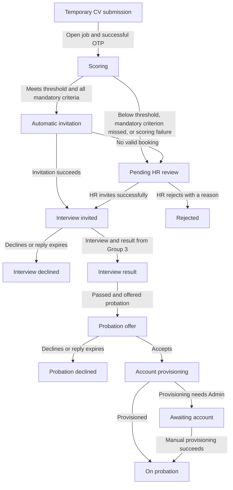

# Business Workflows

Use this reference when turning a use case into a feature spec for HR_Chan.
It covers the 46 use cases selected for the current phase. Each group page
describes expected business behavior. The [implementation notes](implementation-notes.md)
identify existing code, unresolved source differences, and acceptance scenarios.

| Group | Use cases | Start here for |
| --- | --- | --- |
| [Recruitment Management](recruitment-management.md) | UC1.01–UC1.15 | Job postings, versioned scoring criteria, HR review, manual invitations, and reports |
| [Application and Job Recommendations](candidate-application.md) | UC2.01–UC2.13 | CV intake, recommendations, candidate OTP, AI scoring, automatic invitations, consent, and account provisioning |
| [System Administration](system-administration.md) | UC5.01–UC5.18 | Accounts, roles, work reassignment, audit, settings, and password flows |

Group 3 (Interviewing) and Group 4 (Onboarding and Probation) appear at handoff
points. Their detailed actions and screens belong to their own feature work.
UC2.06 is shared with UC5.18 in the source model.

## Sources

| Source file | Where to look |
| --- | --- |
| `Dac_ta_UC_Quan_ly_tuyen_dung.docx` | §§1–4 for the Group 1 diagram, BR01–BR13, detailed flows, and NFRs |
| `Dac_ta_UC_Ung_tuyen_goi_y_viec_lam.docx` | §§1–4 for the Group 2 diagram, BR14–BR26, detailed flows, and NFRs |
| `Dac_ta_UC_Quan_tri_he_thong.docx` | §§1–4 for the Group 5 diagrams, BR27–BR47, detailed flows, and NFRs |
| `Báo cáo CK PRJ3.docx` | Chapter 3 for cross-group flows, Chapter 4 for UML, Chapter 5 for conceptual data and state names, §6.3 for source differences, Chapter 7 for proposed tests, and Appendix A for the UC text |

The group specifications supply the detailed flow and rule references. The report
supplies cross-group context and design history. Where their descriptions differ,
use the [open decisions](implementation-notes.md#open-decisions) to locate the
original passages and confirm the affected contract through the
[engineering workflow](../engineering/workflow.md).

## Actors and Access

| Actor | Business boundary |
| --- | --- |
| Candidate (*Ứng viên*) | Public visitor with no internal account. Submits CVs, selects jobs, verifies email to apply, and replies to invitations through scoped email links. |
| HR | Employee with the `HR` role. Manages jobs, reviews applications, authorizes rejection, sends invitations, and views aggregate reports. Can handle pending work reassignment. |
| Interviewer | Employee with the `INTERVIEWER` role. Access to candidate records is limited to assigned interviews in Group 3. The source actor *Bộ phận tuyển dụng* covers both HR and interviewer, with distinct permissions. |
| Department manager | Employee with the `DEPT_MANAGER` role. Responsible for assigned probation periods in Group 4. Department membership matters when assigning or reassigning this work. |
| Probation employee | Employee with the standalone `PROBATION` role. Access is scoped to their own probation work in Group 4. |
| Admin | Separate account type. Manages accounts, roles, settings, and audit. Business authorization denies Admin access to CVs, scoring detail, and interview results. Reassignment exposes only the administrative work summary. |
| External services | AI extracts, recommends, or scores. Email delivers challenges, links, and notices. Google Workspace handles calendar availability, events, Meet, and company mailboxes. The report's AI Agent and MCP Server are internal design components. |

Internal operations require authentication and server-side authorization. The
password recovery page is a public entry point with its own proof and eligibility
checks. Consent to process a submitted CV and consent to retain a CV for later
recruitment serve different purposes.

## Shared Business Records

| Record | Relationship |
| --- | --- |
| Candidate and CV submission | A candidate can send multiple CVs. A temporary submission represents one upload and any extraction, suggestions, and consent associated with it. |
| Job posting and criteria | A job progresses from Draft to Open to Closed. A criteria save creates a new version. The recommendation threshold filters suggested jobs. The per-job invitation threshold and mandatory criteria determine eligibility for automatic invitations. |
| Application | Created after successful OTP verification for a selected open job. It links the candidate, CV submission, and job. The same email can apply once per job. Scoring and review use saved results and the applicable criteria version. |
| Interview and response link | Each interview has one interviewer. The report permits interview history with at most one active interview per application. A link addresses a specific response and has its own expiry. Interview status, application status, and email delivery outcome are distinct. |
| Probation offer, account, and period | An interview pass can lead to one offer per application. Its acceptance triggers company mailbox and internal account provisioning. The probation period and result provide boundary data for reporting and account lifecycle actions. |

Record names and state identifiers on this page come from the report's conceptual
model in §§5.2–5.4. The [architecture overview](../architecture/overview.md)
describes the repository's current data and runtime.

## Application Lifecycle

| State or transition | Trigger and source |
| --- | --- |
| `SCORING` · Đang chấm điểm | OTP verified and application created (UC2.05, BR19). |
| `PENDING_HR_REVIEW` · Chờ HR duyệt | Low score, missed mandatory criterion, unusable score, or automatic scheduling failure (UC2.08–UC2.09, BR06). Group 3 can return a cancelled interview to HR review (BR55). |
| `INTERVIEW_INVITED` · Đã mời phỏng vấn | Valid slot booked and invitation successfully issued (UC1.09 or UC2.09). See the [delivery decision](implementation-notes.md#invitation-delivery) for partial success. |
| `REJECTED` · Đã từ chối | HR rejects the application with a recorded reason (UC1.10, BR08). |
| `INTERVIEW_CONFIRMED` · Đã xác nhận lịch | Group 3 records the candidate's confirmation (UC3.01). |
| `INTERVIEW_DECLINED` · Từ chối phỏng vấn | Group 3 records an explicit decline, or the system processes an expired interview reply and cancels the event (UC3.01, BR24). |
| `AWAITING_INTERVIEW_RESULT` · Chờ kết quả phỏng vấn | A confirmed interview reaches its start time (Group 3, BR52). |
| `INTERVIEW_PASSED` · Đạt phỏng vấn | An authorized actor records a passing result. This is the input state for the probation offer and response (Group 3, UC3.08–UC3.09). |
| `INTERVIEW_FAILED` · Không đạt phỏng vấn | Group 3 records a failed result or no-show. Its thank-you email can lead to retention consent (UC3.08, UC3.10, UC2.13). |
| `PROBATION_DECLINED` · Từ chối thử việc | Candidate declines or their probation offer expires (UC2.11, BR24). |
| `AWAITING_ACCOUNT` · Chờ cấp tài khoản | Candidate accepts the offer and automatic account provisioning fails (UC2.11–UC2.12). The Admin fallback is UC5.02. |
| `ON_PROBATION` · Đang thử việc | Successful acceptance and provisioning path (UC2.11–UC2.12). See [provisioning timing](implementation-notes.md#probation-handoffs) for partial success. |
| `PROBATION_PASSED` · Đạt thử việc | Group 4 records a passing conclusion. Admin receives the account follow-up under BR44. |
| `PROBATION_FAILED` · Không đạt thử việc | Group 4 records a failing conclusion. BR44 schedules the account lock after the end date. |

The states above apply to an application. The job can close while existing
applications progress. A retention consent reply changes retention eligibility.
An unanswered invitation can move an application to an invitation-specific
decline state under BR24. Only HR can move an application to `REJECTED`.
